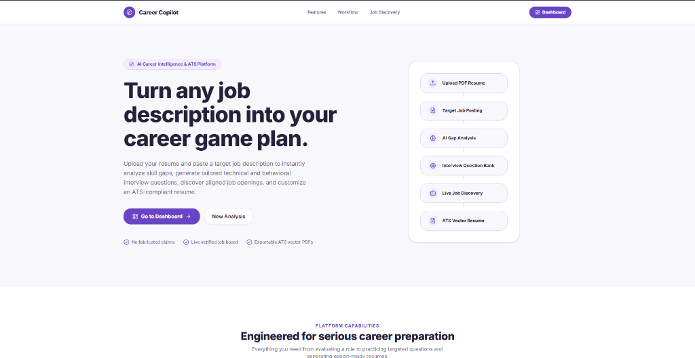
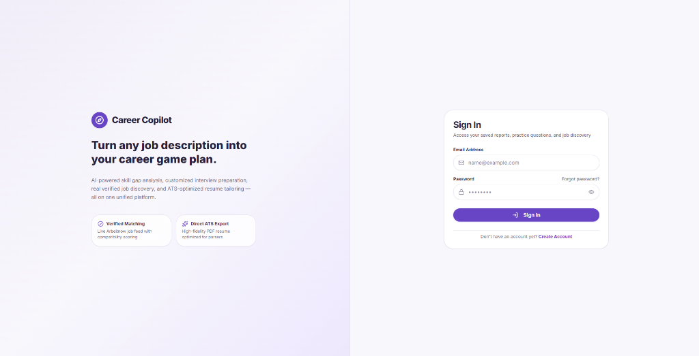
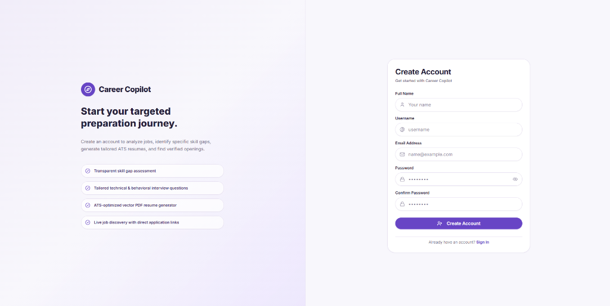
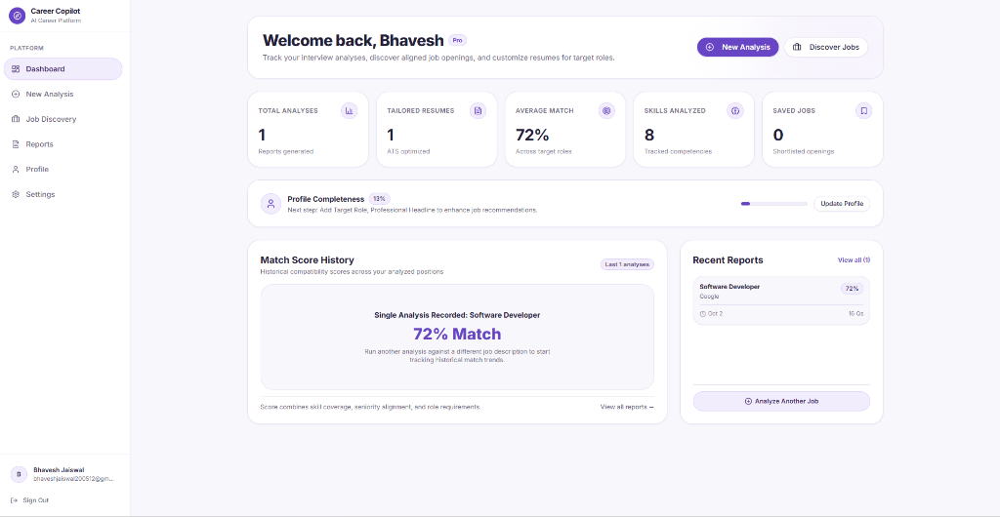
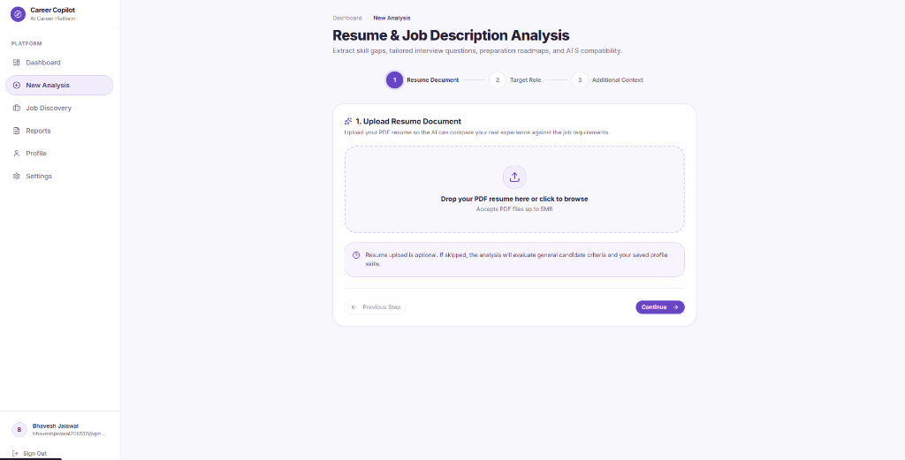
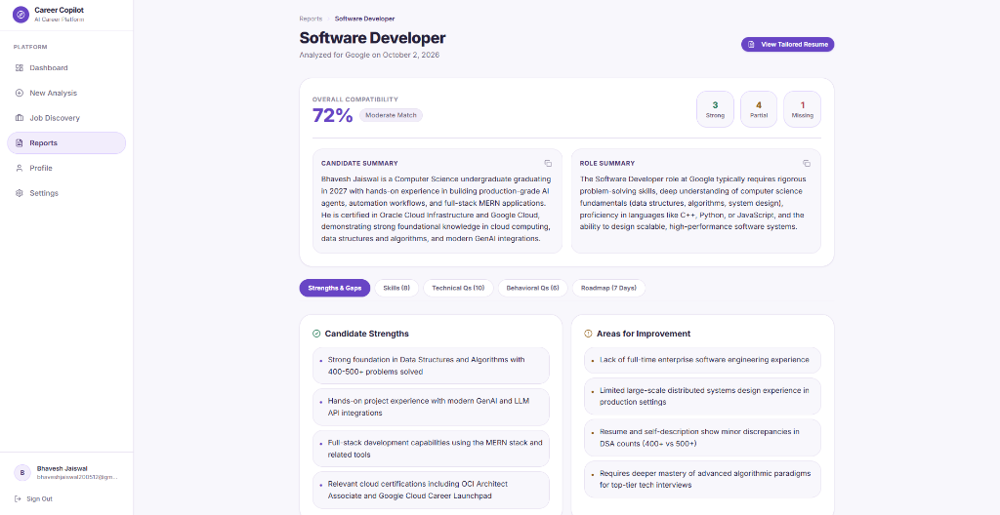
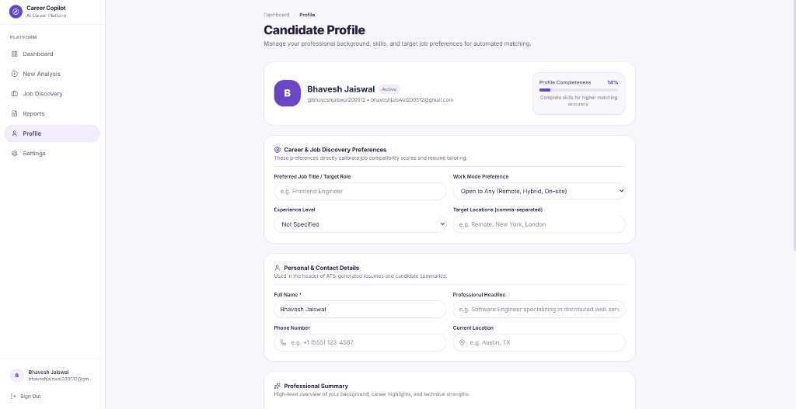
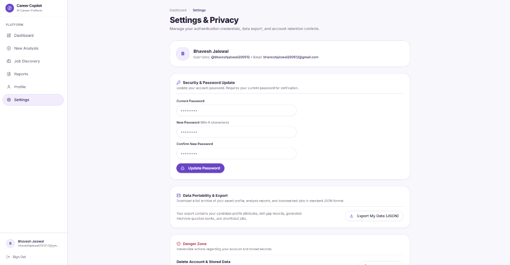

# Career Copilot — AI Career Platform & ATS Resume Engine

> **Turn any target job description into your personalized career game plan.**

Career Copilot is a production-grade, full-stack AI career preparation platform built with the MERN stack and Google Gemini AI. It analyzes candidate resumes against job descriptions, identifies skill gaps, generates targeted interview question banks (technical & behavioral), builds actionable 7-day preparation roadmaps, outputs ATS-optimized resumes with live editing, and provides an English-first real-time job discovery engine with intelligent resume-based location resolution.

---

## 📸 Application Preview

### 1. Landing Page & Product Overview
Clean, modern entry experience with step-by-step feature breakdown and dynamic dashboard navigation.


### 2. Sign In & Session Access
Secure authentication with JWT HTTP-only cookies, password visibility toggle, and credential validation.


### 3. Account Registration & Onboarding
Intuitive registration flow guiding candidates into personalized interview preparation and ATS resume tailoring.


### 4. Unified Career Dashboard
Track interview analyses, job compatibility trends, profile strength gauges, and recent reports in one cohesive workspace.


### 5. Multi-Step Analysis Wizard
Upload PDF resumes or paste plain text, configure target roles, and input job descriptions for deep AI parsing.


### 6. Detailed Interview & Skill Gap Report
View granular compatibility ratings, candidate strengths, areas for improvement, skill gap priority meters, technical and behavioral interview questions, and a 7-day preparation roadmap.


### 7. Candidate Profile & Discovery Preferences
Manage career preferences, target roles, preferred work modes, contact information, education, and skill tags that calibrate job compatibility scores.


### 8. Settings, Security & Data Portability
Manage authentication credentials, password updates, JSON data export, and account retention controls.


---

## ✨ Core Features

### 🔍 Real-Time Job Discovery & Matching
- **English-First Experience**: Detects non-English job postings (such as German listings from European feeds) and automatically translates titles and descriptions into professional English using Google Gemini, preserving company names, links, and salary figures.
- **Inspect Original Listings**: Provides a transparent toggle to inspect original German listings when translated.
- **Smart 4-Tier Country Resolution**:
  1. *Priority 1*: Explicit user search filter / profile preference.
  2. *Priority 2*: Explicit resume location (city, state, or country).
  3. *Priority 3*: Confidently identified education institution location.
  4. *Priority 4*: **India Default** (`IN`) fallback when no reliable country can be determined.
- **Multi-Provider Tech Feeds**: Connects live authorized providers (Arbeitnow & Remotive) with remote scope categorization (Worldwide, India, Regional, On-site).
- **Personalized Compatibility Scoring**: Heuristic scoring engine calculating transparent match percentages based on candidate skills, target role, work mode, and location relevance.
- **Job Bookmarking**: Save and manage shortlisted positions with direct verified application links.

### 📄 AI Resume Analysis & ATS Builder
- **PDF Resume Extraction**: Server-side parsing of uploaded PDF documents into raw and structured candidate profiles.
- **Skill Gap Visualizer**: Categorizes competencies into *Strong*, *Partial*, and *Missing* with priority ratings and learning suggestions.
- **Interview Preparation Engine**:
  - **Technical Questions**: Curated by difficulty, topic, core intent, and expandable expected answer points.
  - **Behavioral Questions**: Structured around the STAR methodology (Situation, Task, Action, Result) with note-saving capabilities.
- **7-Day Actionable Roadmap**: Daily milestone breakdown with estimated time, objectives, and interactive completion tracking.
- **Targeted ATS Resume Synthesis**: Generates ATS-friendly resumes tailored to the target job description.
- **Interactive In-Place Editor**: Live editing of headline, contact info, summary, experience, projects, education, and skills.
- **Live ATS Score Breakdown**: Computes keyword match, skill alignment, experience relevance, and format compliance.
- **Clean PDF Export**: Uses PDFKit and print stylesheets for clean, ATS-compliant PDF downloads.

### 🎨 Design System & Aesthetics
- **Modern Lavender & Purple Theme**: Curated palette utilizing `#6845C5` primary accents, `#F8F7FC` neutral backgrounds, subtle `#E7E1F1` borders, and `#F2EDFC` interactive chips.
- **Responsive Layout**: Designed for mobile, tablet, and desktop with accessible ARIA landmarks, focus states, and smooth micro-interactions.

---

## 🛠️ Technology Stack

| Layer | Technologies |
|---|---|
| **Frontend** | React 19, Vite, Tailwind CSS v4, Lucide Icons, Sonner Toasts, React Router v7, Axios, Recharts |
| **Backend** | Node.js (v20+), Express v5, MongoDB, Mongoose, Multer, pdf-parse, PDFKit |
| **AI & LLM** | Google Gemini API (`@google/genai` with `gemini-3.5-flash` / `gemini-3.1-flash-lite`), Zod schema validation |
| **Job Providers** | Live authorized REST feeds (Arbeitnow Job Board API & Remotive API) |
| **Security & Utilities** | Helmet, CORS, Cookie-Parser, Express-Rate-Limit, BcryptJS, JSONWebToken |
| **Testing** | Node.js native test runner (`node --test`), assert strict |

---

## 📂 Project Structure

```
Resume_Builder/
├── package.json              # Workspace scripts & project runner
├── README.md                 # Project documentation
├── docs/
│   └── images/               # Application UI screenshots
│       ├── landing_hero.png
│       ├── login.png
│       ├── register.png
│       ├── dashboard.png
│       ├── new_analysis.png
│       ├── report_analysis.png
│       ├── profile.png
│       └── settings.png
│
├── client/                   # Frontend SPA (React + Vite)
│   ├── index.html
│   ├── vite.config.js
│   ├── public/
│   └── src/
│       ├── components/       # Reusable UI library (Card, Button, Badge, EmptyState, etc.)
│       ├── context/          # AuthContext & session management
│       ├── layouts/          # AppLayout with sidebar & header
│       ├── pages/            # Dashboard, JobDiscovery, NewAnalysis, Reports, Profile, Settings
│       ├── services/         # Axios API clients (auth, interview, jobService)
│       └── index.css         # Lavender & purple design system tokens
│
└── server/                   # Backend REST API (Node.js + Express)
    ├── package.json
    ├── .env.example
    ├── tests/                # Automated test suites
    │   ├── jobDiscovery.test.js  # 12 test scenarios for country resolution & translation
    │   ├── job.test.js           # Job matching heuristics
    │   ├── ai.test.js            # Gemini error classification
    │   └── unit.test.js          # Auth validators & PDF generation
    └── src/
        ├── app.js            # Express app configuration & middleware
        ├── server.js         # Server bootstrap & MongoDB connection
        ├── controllers/      # Auth, interview, and job controllers
        ├── middleware/       # JWT protection, Multer upload, error handling
        ├── models/           # User, InterviewReport, SavedJob schemas
        ├── routes/           # Auth, interview, and job routes
        └── services/         # AI service, Location service, Translation service, Job service
```

---

## 🚀 Getting Started

### Prerequisites

- [Node.js](https://nodejs.org/) (v20 or higher)
- [MongoDB](https://www.mongodb.com/) (Local instance or MongoDB Atlas cluster)
- [Google Gemini API Key](https://aistudio.google.com/)

### 1. Environment Configuration

In the `server` directory, create a `.env` file based on `.env.example`:

```bash
cd server
cp .env.example .env
```

Ensure the following variables are defined in `server/.env`:

```env
NODE_ENV=development
PORT=5000
CLIENT_URL=http://localhost:5173
SERVER_URL=http://localhost:5000

# MongoDB Connection String
MONGO_URI=mongodb+srv://<username>:<password>@cluster.mongodb.net/career-copilot?retryWrites=true&w=majority

# JWT Credentials
JWT_SECRET=your_super_secret_jwt_key_here_min_32_chars
JWT_EXPIRE=7d

# Google Gemini API
GEMINI_API_KEY=your_gemini_api_key_here
GEMINI_MODEL=gemini-3.5-flash
```

### 2. Install Dependencies

From the project root:

```bash
npm run install:all
```

*(Or run `npm install` inside both `server/` and `client/` directories.)*

---

## 💻 Running the Application

### Start Backend Development Server (Port 5000)
```bash
npm run dev:server
```

### Start Frontend Vite Server (Port 5173)
```bash
npm run dev:client
```

Open [http://localhost:5173](http://localhost:5173) in your browser.

---

## 🧪 Testing & Verification

Run the comprehensive backend test suite (covering location resolution, translations, match heuristics, auth validation, and PDF rendering):

```bash
cd server
npm test
```

Build the frontend bundle to verify bundling and typing:

```bash
cd client
npm run build
```

---

## 📡 Key API Endpoints

### Job Discovery (`/api/jobs`)
| Method | Endpoint | Description | Auth Required |
|---|---|---|:---:|
| `GET` | `/api/jobs` | Discover jobs with location resolution & English translation | **Yes** |
| `GET` | `/api/jobs/saved` | Retrieve user's shortlisted jobs | **Yes** |
| `POST` | `/api/jobs/save` | Bookmark a job to candidate's shortlist | **Yes** |
| `DELETE` | `/api/jobs/:jobId/save` | Remove a job from shortlist | **Yes** |
| `PATCH` | `/api/jobs/:jobId/saved` | Update application status or notes | **Yes** |

### Interview Analysis & Resumes (`/api/interview`)
| Method | Endpoint | Description | Auth Required |
|---|---|---|:---:|
| `POST` | `/api/interview/generate` | Upload PDF resume and generate full AI report | **Yes** |
| `GET` | `/api/interview` | List all historical reports (paginated + search) | **Yes** |
| `GET` | `/api/interview/:id` | Get specific report details | **Yes** |
| `DELETE` | `/api/interview/:id` | Delete an interview report | **Yes** |
| `POST` | `/api/interview/:id/resume/generate` | Synthesize targeted ATS resume with AI | **Yes** |
| `PUT` | `/api/interview/:id/resume` | Save manual resume edits | **Yes** |
| `POST` | `/api/interview/:id/resume/ats-score` | Run ATS compatibility analysis | **Yes** |
| `GET` | `/api/interview/:id/resume/pdf` | Download ATS resume as formatted PDF | **Yes** |

### Authentication & Profile (`/api/auth`)
| Method | Endpoint | Description | Auth Required |
|---|---|---|:---:|
| `POST` | `/api/auth/register` | Register new user account | No |
| `POST` | `/api/auth/login` | Authenticate with credentials | No |
| `POST` | `/api/auth/logout` | Clear HTTP-only session cookie | No |
| `GET` | `/api/auth/me` | Fetch active authenticated session | **Yes** |
| `PUT` | `/api/auth/profile` | Update profile information, skills, and target role | **Yes** |
| `PUT` | `/api/auth/change-password` | Update account password | **Yes** |

---

## 🛡️ License

ISC License. Built for modern software engineering and career acceleration.
